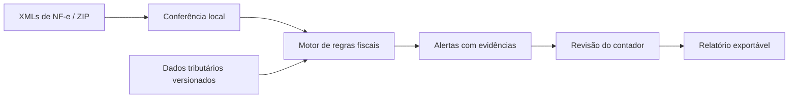
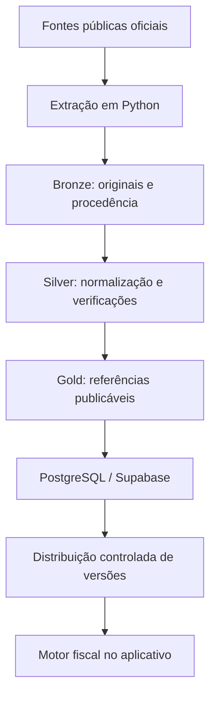

# contAI

### Inteligência fiscal com evidências.

**Conferência de NF-e em lote, dados tributários atualizados e decisões fundamentadas. Sem transformar a rotina do contador em mais uma conversa com IA.**

[Visão do produto](#o-problema) · [Como funciona](#como-o-contai-vai-funcionar) · [Arquitetura](#arquitetura) · [Desenvolvimento](#desenvolvimento) · [Segurança](#privacidade-e-segurança)

 

---

## O problema

Conferir documentos fiscais exige cruzar informações de notas eletrônicas, tabelas tributárias, regras vigentes e particularidades de cada operação. Quando esse trabalho depende de consultas dispersas e verificações repetitivas, investigar divergências e justificar decisões se torna demorado.

A legislação também muda. Uma análise confiável precisa saber **o que era aplicável na data da operação**, de onde veio a informação e **qual versão da regra** foi utilizada.

## Nossa proposta

O **contAI** é uma ferramenta de apoio ao trabalho de contadores e analistas fiscais. Seu objetivo é **transformar lotes de NF-e em conferências verificáveis e pendências acionáveis**, sem substituir o julgamento profissional.

O produto foi concebido sobre três fundamentos:

1. **Verificação antes de opinião.** Cálculos, consistência estrutural e regras fiscais suportadas são avaliados por rotinas determinísticas e testáveis.
2. **Evidência antes de recomendação.** Alertas devem indicar o campo examinado, a regra aplicada, a fonte, a vigência e as limitações da conclusão.
3. **Privacidade por padrão.** O processamento de documentos fiscais será local no aplicativo; dados privados não serão enviados aos nossos servidores no fluxo padrão de conferência.

### Como o contAI vai funcionar

**Exemplo de uso:** um escritório importa um lote de documentos. O contAI identifica duplicidades, inconsistências estruturais e possíveis divergências cobertas pelas regras implementadas. O profissional revisa cada alerta, consulta suas evidências e registra o encaminhamento. Não é necessário que uma IA invente uma conclusão para que o sistema seja útil.

## O que queremos entregar

| Capacidade | Experiência pretendida |
| --- | --- |
| **Conferência em lote** | Importar XMLs e ZIPs de NF-e modelo 55 e visualizar resultados por documento e por item. |
| **Verificações fundamentadas** | Detectar inconsistências suportadas por regras testadas, mostrando motivos e limites. |
| **Referências fiscais atualizadas** | Consultar tabelas e normas com identificação de fonte, captura, vigência e versão. |
| **Painel de análise** | Priorizar alertas, acompanhar pendências e entender padrões nos documentos analisados. |
| **Revisão e exportação** | Registrar o resultado da análise humana e gerar relatórios reproduzíveis. |
| **IA como extensão** | Futuramente, pesquisar legislação e conectar ferramentas do contAI a assistentes compatíveis. |

> **Limite explícito:** ausência de alerta **não** é garantia de conformidade.

## O diferencial está nos dados

A base tributária será desenvolvida como um componente independente do aplicativo.

O projeto terá pipelines próprios em **Python**, com execução automatizada no **GitHub Actions** e armazenamento relacional no **PostgreSQL (Supabase)**.

### Princípios da plataforma tributária

- **Procedência:** URL de origem, identificador da fonte, instante de captura e integridade do conteúdo.
- **Temporalidade:** vigência legal separada da data em que o dado foi observado ou publicado pela plataforma.
- **Reprodutibilidade:** uma conferência deve indicar as versões de dados e regras utilizadas.
- **Qualidade:** cargas idempotentes, validações, tratamento de falhas e monitoramento.
- **Acesso governado:** APIs de leitura com permissões limitadas; credenciais administrativas nunca distribuídas no cliente.

## Arquitetura prevista

| Componente | Tecnologia | Responsabilidade |
| --- | --- | --- |
| Pipeline tributária | Python + GitHub Actions | Captura, normalização, versionamento e qualidade dos dados. |
| Repositório central | Supabase PostgreSQL | Persistir referências tributárias estruturadas e suas versões. |
| Motor fiscal | Python | Analisar NF-e com verificações determinísticas e testes. |
| Aplicativo desktop | Tauri + React + TypeScript | Interface de conferência com processamento local. |
| Banco do aplicativo | SQLite | Histórico e resultados no dispositivo do usuário. |
| Site institucional | Next.js | Apresentação pública, documentação e distribuição. |
| IA e conectores | A definir após o núcleo fiscal | Consulta assistida e integração com plataformas compatíveis. |

A prioridade é manter **pipeline, motor fiscal, aplicativo e landing page independentes**, unidos por contratos simples e versionados. Não há necessidade inicial de microserviços ou processamento distribuído.

## Privacidade e segurança

Projetamos o contAI para tratar documentos fiscais como informação sensível:

- **Local-first:** o XML permanece no dispositivo na conferência padrão.
- **Separação de dados:** a base central armazena dados tributários públicos e referências, não notas fiscais dos clientes.
- **Sincronização verificável:** versões de referências fiscais devem ser autenticadas e verificadas antes de uso.
- **Privilégio mínimo:** nenhuma chave privilegiada do Supabase será embutida no aplicativo.
- **IA opcional e explícita:** qualquer envio de conteúdo a provedores externos dependerá de ação consciente do usuário, de um fluxo documentado e de controles apropriados.

O processamento local **reduz exposição**, mas não dispensa segurança do software, proteção do dispositivo, atualizações, política de retenção e atenção à LGPD.

## Desenvolvimento

A execução será incremental. **Cada etapa precisa de critérios de aceite e testes antes da próxima começar.**

| Etapa | Objetivo | Situação |
| --- | --- | --- |
| **01 · Pipeline tributária** | Extrair e versionar dados oficiais com Python, GitHub Actions e Supabase PostgreSQL. | **Snapshots oficiais iniciais estão versionados em `data/tax-data/`. NCM, TIPI e IBS/CBS publicadas no Supabase `contai-dev`; CEST staged como candidata privada `unresolved`; sitemap CONFAZ arquivado com URLs candidatas; LC 214 capturada e extraída em blocos estruturais, sem interpretação jurídica. O Planalto encerrou a conexão automatizada. Carga e publicação permanecem restritas ao projeto dev.** |
| **02 · Motor fiscal** | Validar documentos sintéticos de NF-e e produzir alertas fundamentados. | Planejada |
| **03 · Aplicativo** | Criar a experiência de conferência local com Tauri. | Planejada |
| **04 · Landing page** | Apresentar o produto e disponibilizar a distribuição. | Planejada |

A documentação técnica e os critérios de cada etapa ficarão em [`docs/`](docs/). As regras de colaboração e desenvolvimento serão definidas em [`AGENTS.md`](AGENTS.md) quando esses arquivos forem criados.

### Etapa 01 — nosso primeiro compromisso

Antes de construir interfaces ou aplicar IA, queremos uma fonte de dados tributários **rastreável, consultável e reproduzível**.

A primeira entrega terá inventário de fontes, extração em Python, armazenamento estruturado, cargas incrementais e idempotentes, execução automatizada, testes e permissões de leitura verificadas. O escopo de fontes será definido após avaliar cobertura, confiabilidade e manutenção de cada origem.

## Identidade visual

O contAI segue uma linguagem **precisa, clara e discreta**: tipografia legível, informação em primeiro plano e cores de estado usadas apenas quando carregam significado.

| Uso | Cor |
| --- | --- |
| Ink | `#141B2B` |
| Blue | `#4878DA` |
| Canvas | `#F5F7FA` |
| Line | `#DDE4ED` |
| Valid | `#21876A` |

A identidade gráfica, o logotipo final e as imagens reais do produto serão desenvolvidos na etapa de design. Evitamos mockups apresentados como telas já implementadas.

---

**contAI** · Menos conferência repetitiva. Mais evidência para decidir.

*Projeto em desenvolvimento — funcionalidades e cobertura fiscal serão divulgadas conforme forem implementadas e verificadas.*

