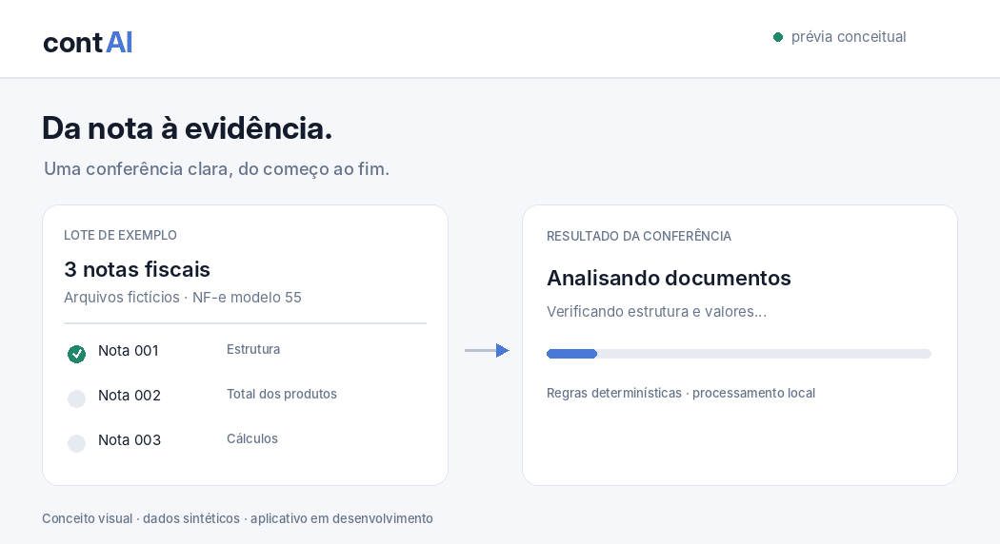
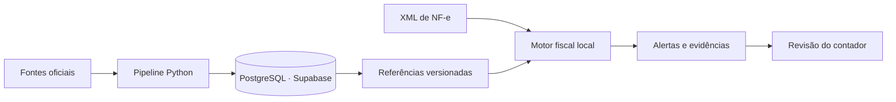

# contAI

**Inteligência fiscal com evidências.**

A legislação muda. As notas se acumulam. A responsabilidade continua sendo do contador.

> **Em desenvolvimento.** A animação ilustra a experiência pretendida; não é uma gravação do aplicativo.

## Por que estamos construindo isso?

Conferir uma nota fiscal não é só verificar se a conta fecha. É entender a operação, consultar regras, identificar inconsistências e conseguir justificar uma decisão.

O problema é que essas informações ficam espalhadas, enquanto as regras mudam e o volume de documentos não espera.

O **contAI** nasce para aproximar essas partes: **dados tributários, conferência automatizada e evidências que o contador pode revisar**. Não para substituir quem decide, mas para reduzir o trabalho repetitivo até chegar à decisão.

## Da fonte à conferência

**O que já existe:** pipelines em Python executadas por GitHub Actions, persistência no Supabase PostgreSQL, controles de procedência e atualização, além de um motor fiscal inicial com validação estrutural e verificações determinísticas de NF-e modelo 55.

**Em desenvolvimento:** um aplicativo desktop com **Tauri** para conferir documentos localmente, visualizar divergências e acompanhar a revisão. O corte atual já cobre XML individual e lote ZIP, mas ainda não está pronto para distribuição pública.

**Mais adiante:** ferramentas de consulta e conectores de IA sobre as referências fiscais, com fontes identificadas, permissões controladas e o contador no centro da decisão.

## Por que desktop?

Uma NF-e pode conter dados sensíveis de empresas e pessoas. Por isso, projetamos o fluxo padrão para **processar os XMLs no computador do usuário**, sem enviá-los para uma plataforma central. O banco em nuvem mantém as **referências tributárias públicas**, não o acervo de notas dos clientes.

## Como está o projeto?

| Frente | Situação |
| --- | --- |
| **Dados tributários** — Python, GitHub Actions e Supabase | Implementada em ambiente de desenvolvimento, com cobertura parcial e controles de versionamento |
| **Motor fiscal** — validação XSD e regras de consistência | Primeira versão implementada e testada com NF-e sintética |
| **Aplicativo desktop** — Tauri | Em desenvolvimento; primeiro corte local para Windows, ainda sem distribuição pública |
| **Landing page** — Next.js | Em desenvolvimento |
| **Conectores com IA** | Planejados |

Acompanhe o projeto em [`docs/`](docs/) ou examine o código em [`packages/`](packages/) e [`apps/`](apps/). A documentação das etapas está em [`pipeline tributária`](docs/01-pipeline-tributaria.md), [`motor fiscal`](docs/02-motor-fiscal.md) e [`aplicativo desktop`](docs/03-aplicativo.md).

---

**contAI** · Menos conferência repetitiva. Mais evidência para decidir.

Ferramenta de apoio à análise fiscal. Nenhuma verificação isolada garante conformidade tributária integral ou substitui a revisão profissional.

