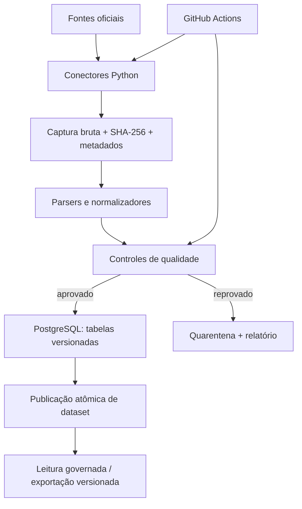

# Etapa 01 — Pipeline tributária

> **contAI · Especificação de execução v2.0 · 30/10/2026**  
> **Status:** Marcos A e B concluídos para a NCM; Marco C implementado e testado em PostgreSQL 17 isolado, com validação no runtime Supabase e acesso remoto ainda não iniciados.
> **Escopo autorizado:** exclusivamente a plataforma de dados tributários. Motor fiscal, desktop, landing page, IA e MCP permanecem fora desta etapa.

## 1. Objetivo

Construir uma base tributária brasileira **rastreável, versionada, reproduzível e consultável** a partir de fontes oficiais, com pipelines em **Python**, automação em **GitHub Actions** e persistência em **Supabase PostgreSQL**.

A plataforma de dados deve permitir responder:

- Qual era o conteúdo de uma tabela ou norma em determinada versão e, quando houver informação suficiente, **na data de vigência da operação**?
- De qual órgão e URL veio cada informação, quando foi capturada e qual artefato/hash a sustenta?
- O que mudou desde a última captura válida?
- O que foi publicado com sucesso, o que falhou e o que aguarda revisão?
- Como um cliente autorizado consulta somente datasets aprovados, sem acesso a credenciais de escrita?

**Não é objetivo desta etapa decidir automaticamente se uma operação fiscal está correta.** Capturar e estruturar legislação não equivale a interpretá-la juridicamente nem autoriza ativação automática de regras fiscais.

## 2. Fontes de contexto, referência open source e limites

Fontes de verdade do trabalho, nesta ordem: `README.md`, `AGENTS.md`, este documento e evidências obtidas nas **fontes governamentais oficiais**. A análise de implementações open source serve para descobrir fontes, comportamentos e casos de borda; as URLs, os formatos e os números citados por terceiros devem ser confirmados na origem. Não copiar código substancial de terceiros sem cumprir sua licença; atribuições obrigatórias podem constar de arquivo próprio, não necessariamente do README público.

### Referência obrigatória de investigação técnica

**Repositório a estudar:** [Matheuscfs/legislacao-tributaria](https://github.com/Matheuscfs/legislacao-tributaria) (licença MIT no momento do levantamento; confirmar no commit efetivamente analisado).

O objetivo é **entender o funcionamento e a cobertura**, não clonar a arquitetura nem transcrever TypeScript para Python. Antes de escrever extratores, inspecionar e registrar no inventário:

| Arquivo/diretório de referência | Pergunta que deve responder |
|---|---|
| [`README.md`](https://github.com/Matheuscfs/legislacao-tributaria/blob/main/README.md) | Quais dados e restrições são declarados? Quais números precisam de validação? |
| [`scripts/capturar.ts`](https://github.com/Matheuscfs/legislacao-tributaria/blob/main/scripts/capturar.ts) | Como fontes e capturas são orquestradas? Como erros e alterações são tratados? |
| [`src/fonte.ts`](https://github.com/Matheuscfs/legislacao-tributaria/blob/main/src/fonte.ts) | Quais problemas de HTTP, charset e integridade aparecem? |
| [`src/ncm.ts`](https://github.com/Matheuscfs/legislacao-tributaria/blob/main/src/ncm.ts) | Qual schema de NCM e qual vigência podem ser recuperados? |
| [`src/ibs-cbs.ts`](https://github.com/Matheuscfs/legislacao-tributaria/blob/main/src/ibs-cbs.ts) | Como CST, cClassTrib e relações NCM/NBS são representados? |
| [`src/cest.ts`](https://github.com/Matheuscfs/legislacao-tributaria/blob/main/src/cest.ts) e [`src/tipi.ts`](https://github.com/Matheuscfs/legislacao-tributaria/blob/main/src/tipi.ts) | Como tratar segmentos, exceções, alíquotas e mudanças? |
| [`src/planalto.ts`](https://github.com/Matheuscfs/legislacao-tributaria/blob/main/src/planalto.ts) e [`src/confaz.ts`](https://github.com/Matheuscfs/legislacao-tributaria/blob/main/src/confaz.ts) | Como preservar redações anteriores, remissões e alterações? |
| [`src/descoberta.ts`](https://github.com/Matheuscfs/legislacao-tributaria/blob/main/src/descoberta.ts) | Como detectar candidatos a novas normas sem publicá-las automaticamente? |
| [`.github/workflows/capturar.yml`](https://github.com/Matheuscfs/legislacao-tributaria/blob/main/.github/workflows/capturar.yml) | Que periodicidade, permissões e dependências externas a automação utiliza? |
| [`LICENSE`](https://github.com/Matheuscfs/legislacao-tributaria/blob/main/LICENSE) | Quais obrigações de licença se aplicam a eventual reutilização? |

Registrar o **SHA do commit de referência**, data da consulta e arquivo estudado. Links acima apontam para `main` e podem mudar: para reproduzibilidade, fixar o SHA no inventário, sem congelar para sempre o monitoramento de fontes oficiais.

**Entregável de pesquisa:** matriz curta `fonte oficial → tratamento na referência → solução Python proposta → evidência → risco → decisão`. Classificar cada insight como `confirmado na origem`, `observado apenas na referência` ou `hipótese`. Não transformar um dado citado no README terceiro em fato sobre a fonte oficial sem verificação.

**Licenciamento:** legislação e tabelas oficiais podem ser estudadas diretamente nas fontes. Se o código, testes, arquivos criativos ou trechos substanciais forem copiados/adaptados da referência, preservar avisos e atribuição exigidos pela licença MIT; não ocultar atribuição obrigatória para atender à preferência de não mencionar a referência no README de marketing. Se a implementação for independente, deixar isso claro no inventário. Não copiar um corpus transformado do outro projeto para simular uma captura oficial própria.

Cobertura desejada, baseada no inventário inicial da referência técnica:

| Domínio | Fontes oficiais a investigar | Estruturas de interesse | Prioridade de implementação |
|---|---|---|---|
| **NCM** | Portal Único Siscomex | Código, descrição, hierarquia, ato, início/fim de vigência | **P0: primeiro fluxo vertical** |
| **IBS/CBS** | SVRS / Conformidade Fácil e documentação fiscal oficial | CST, cClassTrib, condições, percentuais, vínculos NCM/NBS, vigências | P1 |
| **CEST** | CONFAZ, Convênio ICMS 142/2018 e alterações | Código, segmento, descrição, vínculos NCM, atos | P1 |
| **TIPI** | Receita Federal / publicação oficial da TIPI | NCM, EX, descrição, alíquota, exceção, vigência | P1 |
| **Leis federais selecionadas** | Planalto / publicação oficial | Ato, artigo/dispositivo, texto, remissões, versões, vigência verificável | P2 |
| **CONFAZ** | Site oficial: convênios, protocolos, ajustes SINIEF | Tipo/número/ano, ementa, redações, vínculos, efeitos | P2 |
| **Descoberta de novas normas** | Índices oficiais do Planalto e fontes publicáveis | Novos atos candidatos e alterações detectadas | P2 |

**P0/P1/P2 são ordem de entrega, não permissão para ampliar o escopo.** A etapa 01 almeja cobertura dessas famílias, mas cada fonte só será considerada suportada depois de ser verificada, testada e publicada. Não afirmar cobertura completa do Brasil ou de todos os benefícios de ICMS. Fontes estaduais, Sijut, CGSN, NBS completa e demais amplificações são backlog sujeito a decisão futura.

### Inventário inicial a confirmar no código/fonte oficial

O projeto de referência possui extratores de NCM, TIPI, CEST, IBS/CBS, Planalto e CONFAZ; identifica mudanças no CONFAZ via sitemap; preserva redação antiga em normas compiladas; e registra novas leis complementares candidatas à curadoria. São **comportamentos a estudar**, não código a transportar nem garantia de cobertura atual. Investigar particularmente: `charset` divergente em portais antigos, tabelas HTML irregulares, datas de vigência incompletas, anexos, códigos com zeros à esquerda e relações NCM–CEST–cClassTrib que dependem de condições legais.

Registrar no inventário, para cada fonte: órgão responsável; página/documentação oficial; URL de dados; tipo de acesso; formato; periodicidade; política de atualização; limite de requisições; restrição de acesso; licença/condições; campos; chave natural; vigência; tamanho estimado; e testes de disponibilidade. **Não presumir endpoint estável sem verificar.**

## 3. Decisões técnicas

| Área | Decisão |
|---|---|
| Runtime | Python 3.12 ou superior, versão concreta fixada no projeto |
| Gerenciador | `uv`, com lockfile versionado |
| Coleta | Cliente HTTP Python com timeout, limites, backoff e identificação do cliente; parsing por formato |
| Transformação | Python tipado e SQL explícito, sem Spark nem ORM pesado |
| Dados tabulares | PostgreSQL no Supabase; preservar códigos fiscais como `TEXT` |
| Originais | Arquivo imutável de captura com checksum e metadados; escolher armazenamento viável antes da primeira carga completa |
| Versionamento | Conteúdo por hash, versões de dataset e vigência fiscal separadas |
| Automatização | GitHub Actions: CI separado da captura agendada e execução manual |
| Qualidade | `pytest`, `ruff`, verificação de tipos; testes com fixtures offline |
| Migrações | SQL versionado e Supabase CLI; implantação remota mediante aprovação |
| Interface externa | Nenhuma API própria na primeira entrega; publicação somente de visões/datasets aprovados |

**Decisão pendente de aprovação:** armazenamento de originais grandes. Padrão sugerido: Supabase Storage **privado** para blobs brutos (ou alternativa de objetos compatível) e PostgreSQL para metadados, dados normalizados e referências. Não colocar milhares de documentos longos ou binários em tabelas expostas; verificar cotas, custos e políticas antes de provisionar.


### Política de decisão e autonomia durante a etapa

O Codex pode, sem interrupção: pesquisar repositórios públicos e fontes oficiais, criar código local, fixtures, migrações **sem aplicá-las remotamente**, executar testes offline, corrigir falhas, atualizar documentação e efetuar commits locais de alterações próprias. **Não** deve criar projetos cloud, executar migrações ou cargas remotas, alterar políticas de acesso/segredos, habilitar agenda, criar recursos pagos ou fazer push/deploy sem autorização. Caso uma dessas ações bloqueie o marco, entregar artefato local testado e uma pergunta objetiva com proposta, impacto e alternativa.

Para cada marco: (1) inspecionar estado real do repositório; (2) definir saída observável; (3) implementar o menor fluxo vertical verificável; (4) rodar testes e checagens; (5) registrar evidências, pendências e decisão de avanço. Não criar arquivos/pacotes vazios nem frameworks de extensibilidade especulativos.

### Matriz de verificação por domínio

Cada conector somente recebe status `suportado` quando houver: URL oficial e termos de acesso confirmados, artefato original retido quando permitido, schema versionado, casos positivos e negativos de teste, controle de carga idempotente, relatório de diferença, política de publicação e consulta reprodutível. Caso contrário: `em investigação`, `parcial` ou `bloqueado`, com motivo.

## 4. Arquitetura lógica



**Bronze / Silver / Gold são responsabilidades, não três bancos obrigatórios.**

- **Bronze:** bytes originais, URL, status HTTP, `etag`/`last_modified` quando existirem, hash SHA-256, instante de coleta, identificador de execução e status. Evitar dados secretos ou privados.
- **Silver:** registros normalizados, histórico por versão, vínculos e datas de vigência com tipos controlados.
- **Gold:** snapshots de referência aprovados para consulta. Publicar apenas depois de testes de qualidade e consistência; consumidores devem enxergar **a última versão válida**, inclusive durante falhas de ingestão.

### Modelo lógico mínimo (para primeira fonte)

Não implementar todas as tabelas do roadmap antes de validar a NCM. Entidades mínimas:

- `source_registry`: identificador, órgão, nome, URL oficial, formato, política de atualização, situação.
- `ingestion_run`: fonte, início/fim, status, estatísticas, erro sanitizado, versão do coletor.
- `source_artifact`: execução, hash, URI privada, cabeçalhos de controle, data de observação e tamanho.
- `dataset_release`: domínio, versão, data de criação, hash do conjunto, status (`candidate`, `published`, `rejected`), artefato(s), contagens e publicação.
- `ncm_entry`: código como texto, descrição, hierarquia, identificador do ato quando fornecido, `valid_from`, `valid_to`, `release_id`, identificador da linha/origem.
- `quality_result`: execução, verificação, severidade, quantidade, estado e detalhes não sensíveis.

Prever chaves, índices e constraints para unicidade de `(release_id, codigo)` quando cabível, integridade referencial e consultas por código e vigência. **Não substituir relações muitos-para-muitos por uma única coluna de classificação.**

A arquitetura completa de normas poderá exigir `legal_act`, `legal_provision`, `provision_version`, `legal_reference` e vínculos de alteração; **modelar quando chegar ao domínio jurídico**, após analisar fontes e sem inferir vigências a partir de marcas visuais de HTML. Não declarar automaticamente que toda redação antiga está juridicamente revogada só porque aparece riscada.

### Temporalidade obrigatória

Tratar separadamente:

1. **Observação:** quando o contAI capturou a fonte (`captured_at`).
2. **Publicação da origem:** quando o órgão publicou o ato, se informado (`source_published_at`).
3. **Vigência/efeitos:** quando norma ou código produz efeito (`valid_from`, `valid_to`), quando verificável.
4. **Publicação contAI:** versão que a plataforma aprovou para consumo (`released_at`).

Campo desconhecido permanece `NULL` e ganha alerta; não preencher por suposição.

## 5. Estratégia de coleta e atualização

1. **Discover:** consultar catálogo/manifesto da fonte; validar URL, disponibilidade e limites.
2. **Fetch:** baixar com tempo limite, retentativas com jitter e limites totais; respeitar `429` e `Retry-After` quando presentes.
3. **Detect change:** comparar ETag/Last-Modified **quando confiáveis** e, principalmente, hash do conteúdo original/normalizado; ausência de alteração não cria versão.
4. **Archive:** persistir original imutável e metadados; falha de arquivamento impede avançar se comprometer reprodutibilidade.
5. **Parse/normalize:** padronizar codificação, tipos, datas, strings e referências, preservando texto original e exceções relevantes.
6. **Validate:** executar checks de esquema, domínios, unicidade, integridade, contagens e consistência de intervalos.
7. **Stage:** gravar candidato isolado, sem modificar a versão publicada.
8. **Publish:** transação que ativa a nova versão somente com verificações aprovadas.
9. **Observe:** emitir resumo de execução, mudanças, qualidade, falhas e providências.

**Carga inicial:** backfill controlado e paginado, com checkpoint por fonte e limites de tráfego. **Carga diária:** apenas o que mudou. Uma mudança de formato, número suspeito de registros ou falha de autenticação bloqueia publicação; não apaga dados previamente válidos.

Para o CONFAZ, verificar a disponibilidade e semântica de `lastmod` do sitemap. O projeto estudado relata restrição geográfica de acesso; **não implementar proxy ou contornar controles automaticamente**. Caso a captura do runner GitHub falhe por região, registrar evidência e solicitar decisão entre execução autorizada em infraestrutura brasileira, acesso oficial alternativo ou adiamento do conector.

## 6. Segurança e governança no Supabase

- Manter **ingestão, artefatos e logs em schemas/armazenamento privados**; não expor todo `public` como catálogo bruto.
- Credenciais privilegiadas de escrita somente em runners/servidores confiáveis; nunca em frontend, cliente desktop, README, artefatos de CI ou `.env` commitado.
- Consumidores de leitura só enxergam datasets explicitamente publicados. Definir e testar `GRANT`, RLS quando o schema estiver exposto e políticas por função/escopo; **autenticação não equivale a autorização**.
- Preferir visões de leitura com direitos do invocador quando compatíveis, ou API intermediária se a governança exigir. Não assumir que views respeitam RLS automaticamente.
- Separar ambiente de desenvolvimento/teste do banco compartilhado de produção. Testes de CI não alteram produção.
- Configurar segredos no ambiente adequado após aprovação. Não provisionar planos pagos, recursos remotos, políticas, chaves ou migrações de produção sem autorização explícita.
- Validar superfície de exposição e limites de exportação; proteger scripts da ingestão contra injeção SQL, URLs controladas por terceiros e alterações de dependências.
- Na etapa 01, **não coletar nem armazenar NF-e de clientes**; somente dados tributários públicos.

## 7. GitHub Actions

Manter workflows separados:

- **CI (`ci.yml`):** `uv sync --frozen`, `ruff check`, formatação, tipagem, `pytest` e verificação de migrações/fixtures sem acesso a serviços externos. Permissão `contents: read`.
- **Captura (`capture.yml`):** `workflow_dispatch` e agendamento, inicialmente restrito a fontes implantadas. Concurrency por fonte; proteção de secrets; execução com tempo máximo; logs sanitizados; resumo do lote. Publicação externa só após configuração aprovada.

Evitar workflow que faz `git commit` de todo o corpus a cada execução; o histórico principal ficará no armazenamento de dados e no catálogo de versões. Manter no Git **código, migrações, fixtures pequenas, contratos e documentação**, não volumes brutos massivos.

## 8. Organização sugerida dos arquivos da etapa

```text
contai/
├── README.md
├── AGENTS.md
├── docs/
│   └── 01-pipeline-tributaria.md
├── packages/
│   └── tax-data/
│       ├── pyproject.toml
│       ├── uv.lock
│       ├── src/contai_tax_data/
│       │   ├── sources/
│       │   ├── extract/
│       │   ├── transform/
│       │   ├── quality/
│       │   ├── storage/
│       │   └── cli.py
│       └── tests/
│           ├── fixtures/
│           ├── unit/
│           └── integration/
├── infra/
│   └── supabase/
│       └── migrations/
└── .github/
    └── workflows/
        ├── ci.yml
        └── capture.yml
```

A árvore é orientação, não ordem para criar arquivos vazios. Ajustar ao comportamento real do código. Não criar `apps/desktop`, `apps/website`, FastAPI ou pacotes futuros nesta etapa.

## 9. Plano incremental de execução

### Marco A — inventário e especificação do primeiro contrato

- Ler os extratores e a documentação da referência técnica, **sem copiar código**.
- Acessar as fontes oficiais e confirmar URLs, formatos, campos, políticas e vigência.
- Montar matriz de cobertura com evidências e indicar restrições técnicas/legais.
- Escolher a **NCM** como primeiro dataset; fixar schema, chave natural, checks de qualidade e contrato de consulta.
- Registrar decisões pendentes e riscos neste documento, sem criar ADRs separados.

**Aceite:** inventário verificável de NCM e demais famílias prioritárias, SHA da referência investigada, matriz comparativa, primeira especificação de campos e fonte oficial reproduzível. O inventário deve registrar problemas de acesso e casos de teste antes da implementação.

### Marco B — fluxo vertical NCM, local e testado

- Inicializar `uv` e estrutura mínima de pacote Python.
- Implementar downloader e decodificação, normalizador e verificador NCM.
- Salvar artefato bruto e manifesto local; produzir registros normalizados.
- Validar campos obrigatórios, códigos, datas, unicidade, contagens e mudança de fonte.
- Criar fixtures sem acesso externo e testes de timeout, mudança real, reexecução e regressão.

**Aceite:** uma execução local íntegra gera snapshot NCM reproduzível; segunda execução idêntica não gera nova versão.

### Marco C — PostgreSQL e publicação governada

- Escrever migrações SQL versionadas para as entidades mínimas.
- Aplicar e testar em **ambiente isolado**, mediante aprovação quando remoto.
- Implementar staging e publicação atômica; índices e consultas por código e vigência.
- Validar privilégios de leitura/escrita, RLS se aplicável, e impossibilidade de leitura do bruto por cliente comum.
- Reexecutar o mesmo lote e testar falha no meio da carga sem quebrar a versão publicada.

**Aceite:** carga idempotente e histórico verificável em PostgreSQL de teste; segurança testada; consulta funcional e versionada.

### Marco D — CI e atualização controlada

- Configurar CI offline e captura manual, observabilidade e relatórios.
- Habilitar agenda apenas após testes suficientes e autorização para acesso remoto.
- Simular mudança de tabela e falha de captura; confirmar a permanência da última release válida.

**Aceite:** workflows confiáveis com testes, status, identificação de falhas e sem vazamento de segredos.

### Marco E — expansão por domínio

Seguir a ordem **IBS/CBS → CEST → TIPI → leis federais → CONFAZ/descoberta**. Para cada domínio repetir inventário, extração, parsing, modelo, qualidade, versionamento, consulta, testes e publicação. Prioridades podem ser revistas com justificativa, mas **não publicar um conector não validado**. Para normas, priorizar fidelidade de texto, estrutura de dispositivos e remissões antes de pesquisa semântica.

**Aceite:** matriz de cobertura atualizada, testes por fonte, snapshots aprovados e limitações explicitadas.

## 10. Critérios globais de qualidade (Definition of Done)

A etapa 01 só pode ser declarada concluída quando:

- [ ] Fontes incluídas no escopo possuem procedência oficial verificável e registro de limitações.
- [ ] Inventário técnico compara explicitamente o projeto de referência com as fontes oficiais, incluindo SHA de referência e decisão implementar/adaptar/descartar por comportamento.
- [ ] Cada domínio declarado como suportado tem extrator, parser, normalização e testes.
- [ ] Existe recuperação/reprocessamento de versão a partir do artefato original (quando disponível e autorizado).
- [ ] Cargas são idempotentes, detectam mudanças e preservam histórico.
- [ ] Vigência jurídica e data de captura não são confundidas.
- [ ] Dados suspeitos ficam em quarentena; falhas não substituem releases válidas.
- [ ] Catálogo e SQL de consultas principais têm testes e índices pertinentes.
- [ ] Permissões de leitura e escrita são demonstradas com teste de acesso negativo.
- [ ] CI executa testes offline sem secrets de produção.
- [ ] Workflow de captura tem execução/monitoramento confiáveis para as fontes ativadas.
- [ ] Há documentação para rodar carga inicial, incremental, testes e recuperação de falhas.
- [ ] README reflete as funcionalidades efetivamente concluídas, sem promessas indevidas.

**Regra de relato:** uma etapa parcial deve ser descrita como parcial, com os domínios efetivamente suportados. O marco D com NCM não implica que toda a etapa 01 foi concluída.

## 11. Riscos e decisões que precisam de aprovação

| Questão | Recomendação | Gatilho para aprovação |
|---|---|---|
| Supabase | Começar por ambiente de desenvolvimento isolado | Criar projeto, executar migrações/cargas remotas, mudar grants/RLS |
| Armazenamento de originais | Objeto privado + hash referenciado no catálogo | Escolha de provedor, cotas ou custos |
| CONFAZ fora do Brasil | Testar acesso legítimo; documentar falhas | Runner brasileiro, proxy ou serviço externo |
| Cópia de terceiro | Implementação própria e testes de comportamento | Qualquer reutilização substancial de código sujeito a licença |
| Regras legais | Publicar dados, não conclusões jurídicas automáticas | Ativação de regras normativas para o motor fiscal |
| Exposição da base | Só datasets aprovados; acesso por menor privilégio | Abertura de endpoint público, tokens de usuário ou mudanças de RLS |

Não pedir confirmação para cada função, teste, diretório ou commit local. **Perguntar somente pelo ponto crítico e continuar o que for seguro em paralelo.**

## 12. Resultado do Marco A e preparação local do Marco B

Levantamento realizado em **30/10/2026**. URLs e contagens abaixo são evidências datadas, não promessa de estabilidade. A classificação `confirmado na origem` significa que a página, documentação ou artefato oficial foi consultado; `observado apenas na referência` não é tratado como contrato oficial; `hipótese` exige nova verificação antes de implementar.

### 12.1 Referência técnica fixada

- Repositório: [`Matheuscfs/legislacao-tributaria`](https://github.com/Matheuscfs/legislacao-tributaria).
- Commit estudado: [`94a27084e158ef4c62a317822b3d2d2b517858ad`](https://github.com/Matheuscfs/legislacao-tributaria/tree/94a27084e158ef4c62a317822b3d2d2b517858ad), de `2026-10-30T15:34:28Z`.
- Licença nesse commit: MIT, copyright 2026 Matheus Fachim.
- Arquivos lidos: `README.md`, `LICENSE`, `scripts/capturar.ts`, `src/fonte.ts`, `src/ncm.ts`, `src/ibs-cbs.ts`, `src/cest.ts`, `src/tipi.ts`, `src/planalto.ts`, `src/confaz.ts`, `src/descoberta.ts`, `.github/workflows/capturar.yml` e os quatro arquivos de testes.
- Uso no contAI: estudo de comportamento e descoberta de casos de borda. A implementação Python foi escrita de forma independente; nenhum código, teste ou corpus transformado da referência foi copiado.

### 12.2 Matriz comparativa

| Fonte oficial | Tratamento observado na referência | Solução Python do contAI | Evidência e classificação | Risco | Decisão |
|---|---|---|---|---|---|
| NCM — Portal Único Siscomex | Baixa o JSON vigente, remove do resultado a data diária, converte `31/12/9999` em fim aberto, ordena e compara CSV. | Contrato JSON estrito, bruto imutável por SHA-256, normalização tipada, hierarquia pelo ancestral existente, release por hash semântico e JSONL local. | Endpoint, manual, campos e limitação ao vigente: **confirmados na origem**. Estratégia da referência: **observada apenas na referência**. | Cabeçalho `Vigente em` muda sem mudança tributária; download não traz histórico passado/futuro. | **Implementar agora**, sem importar código terceiro; status `parcial-local` até publicação governada. |
| IBS/CBS — SVRS/Conformidade Fácil | Extrai `dadosOriginais` embutido no HTML e gera CST, cClassTrib e vínculos NCM/NBS. | Preferir os serviços oficiais `classTrib` e `anexos`; só recorrer a HTML após contrato e termos confirmados. Modelar vínculos muitos-para-muitos e condições. | Página, exportações e URLs de serviços v1.00: **confirmados na origem**. Estrutura interna do JavaScript: **observada apenas na referência**. | API direta sofreu reset no teste; contrato, limites e estabilidade ainda não verificados. | **Não implementar neste marco**; manter `em investigação`. |
| CEST — CONFAZ, Convênio ICMS 142/18 | Lê tabelas HTML, ignora linhas marcadas como redação antiga e usa `(CEST, NCM)` para linhas. | Preservar original e notas legais; separar CEST, segmento e relação CEST–NCM com vigência verificável. | Convênio e tabelas acessíveis: **confirmados na origem**. Regras de classes HTML antigas: **observadas apenas na referência**. | HTML compilado irregular; revogação e efeitos não são campos uniformes por linha. | **Não implementar neste marco**; exigir fixtures por época e revisão jurídica de vigência. |
| TIPI — Receita Federal | Lê XLSX, filtra linhas de produto e usa `(NCM, EX)`; toma o último ato da capa como atualização. | Ler XLSX oficial preservando texto rico quando relevante; separar linha, exceção, alíquota e ato, sem inventar vigência por linha. | Página, XLSX e atualização: **confirmados na origem**. Heurística do último ato: **observada apenas na referência**. | Notas de seção/capítulo e efeitos dos atos podem não estar estruturados. | **Não implementar neste marco**; contrato depende de amostras históricas. |
| Leis federais — Planalto | Converte HTML compilado em Markdown, mantendo texto riscado; monitora catálogo explícito. | Futuro modelo de ato, dispositivo, versão e remissão; guardar HTML e não inferir revogação pelo estilo. | Textos compilados individuais: **confirmados na origem**. Conversão e marcações antigas: **observadas apenas na referência**. | Charset legado, bloqueio automatizado, tabelas irregulares e vigências textuais. | **Não implementar neste marco**; conteúdo exige curadoria. |
| CONFAZ — convênios, protocolos e ajustes | Descobre páginas por sitemap/`lastmod`, converte HTML e relata bloqueio geográfico em runners externos. | Validar semântica de `lastmod`, limitar concorrência e volume; não usar proxy sem aprovação. | Sitemap e página do Convênio 142 acessíveis no teste: **confirmados na origem**. Bloqueio fora do Brasil: **observado apenas na referência**. | Restrição geográfica pode impedir GitHub Actions; `lastmod` pode não equivaler a mudança normativa. | **Não implementar neste marco**; manter `em investigação`. |
| Descoberta de novas normas — índices do Planalto | Lê o quadro de leis complementares e classifica ementas candidatas; abre issue para curadoria. | Descoberta apenas cria candidato, nunca publicação automática; ampliar fontes somente após acesso oficial estável. | Quadro oficial existe, mas bloqueou/expirou nos testes automatizados: **confirmado na origem com problema de acesso**. Classificador de ementa: **observado apenas na referência**. | Falsos positivos/negativos e bloqueio anti-automação. | **Bloqueado para automação atual**; não contornar controles. |

### 12.3 Inventário verificável de fontes

| Domínio e situação | Órgão, página e URL de dados | Acesso, formato e atualização | Condições e restrições | Campos, chave e temporalidade | Tamanho e teste de disponibilidade |
|---|---|---|---|---|---|
| **NCM — parcial-local** | RFB/Ceclam, [página de download](https://www.gov.br/receitafederal/pt-br/assuntos/aduana-e-comercio-exterior/classificacao-fiscal-de-mercadorias/download-ncm-nomenclatura-comum-do-mercosul), [manual do Classif](https://www.gov.br/siscomex/pt-br/arquivos-e-imagens/2021/07/ClassifManualdoUsuariov5.0.pdf), [JSON](https://portalunico.siscomex.gov.br/classif/api/publico/nomenclatura/download/json). | HTTPS GET público, sem captcha no link direto; redireciona para `?perfil=PUBLICO`; JSON UTF-8. A página de integração informa atualização diária à meia-noite. | Sem limite de requisições ou licença específica do dataset identificados. Usar baixa frequência, cache e termos gerais dos portais; não presumir SLA. | Raiz: `Data_Ultima_Atualizacao_NCM`, `Ato`, `Nomenclaturas`. Linha: código, descrição, início/fim, tipo/número/ano do ato inicial. Chave `(release_id, code)`; `31/12/9999` vira `NULL`. O arquivo cobre somente o vigente; histórico é consulta separada no Classif. | Em `2026-10-30T23:31:50Z`: HTTP 200, `application/json`, 3.149.450 bytes, SHA-256 `dfae9ea93ddaa01512009739341c38a01dd7a1d2c3e2fdf089f46dbe970d2fb5`, 15.157 linhas, 10.516 subitens, 96 capítulos, sem códigos duplicados. |
| **IBS/CBS — em investigação** | SVRS/ENCAT, [tabela online](https://dfe-portal.svrs.rs.gov.br/CFF/ClassificacaoTributaria), [serviços](https://dfe-portal.svrs.rs.gov.br/CFF/Servicos), API `https://cff.svrs.rs.gov.br/api/v1/consultas/classTrib` e `.../anexos`. | Página pública com CSV/Excel/JSON; serviços v1.00 publicados. Atualização declarada como periódica. | Limites e licença específica não publicados nas páginas consultadas. Janela de manutenção oficial aos domingos, 07h–09h. API direta resetou a conexão neste ambiente. | CST, cClassTrib, indicadores, reduções, documentos e anexos/vínculos. Chaves candidatas: CST, cClassTrib e vínculo composto; vigências existem na representação observada, mas o contrato da API precisa ser confirmado. | Página: HTTP 200 e cerca de 4,19 MB em 30/10/2026. No SHA de referência: 18 CST, 173 classes e 4.728 vínculos — números **não validados como contagem oficial atual**. |
| **CEST — em investigação** | CONFAZ, [Convênio ICMS 142/18 compilado](https://www.confaz.fazenda.gov.br/legislacao/convenios/2018/CV142_18). | HTTPS público, HTML com anexos; atualização por atos modificadores, sem periodicidade fixa. | Sem limite/licença específica identificados. Acesso pode depender de região segundo a referência; não usar proxy sem aprovação. | Segmento, item, CEST, NCM/SH, descrição e notas de alteração. Relação muitos-para-muitos; chave candidata `(release_id, cest, ncm, item)`. Vigência deve vir dos atos/notas, não da captura. | HTTP 200, `text/html`, 933.142 bytes em 30/10/2026. Referência: 25 segmentos, 1.302 linhas e 1.053 CEST — apenas estimativa. |
| **TIPI — em investigação** | Receita Federal, [página TIPI](https://www.gov.br/receitafederal/pt-br/acesso-a-informacao/legislacao/tipi-tabela-de-incidencia-do-imposto-sobre-produtos-industrializados), [XLSX](https://www.gov.br/receitafederal/pt-br/acesso-a-informacao/legislacao/documentos-e-arquivos/tipi.xlsx). | HTTPS público; PDF, DOCX e XLSX. Atualização por decreto/ADE, sem agenda fixa publicada. | Sem limite/licença específica identificados; preservar formatação e atos da planilha. | NCM, EX, descrição, alíquota e notas/atos. Chave candidata `(release_id, ncm, ex)`; vigência não é uniforme por linha e deve ser derivada somente de ato verificável. | HTTP 200, XLSX, 673.645 bytes; página do arquivo atualizada em 13/02/2026. Referência: 15.563 linhas — estimativa. |
| **Leis federais — em investigação** | Presidência da República/Planalto, [índice de legislação](https://planalto.gov.br/ccivil_03/leis/_lei-principal.htm) e URLs individuais catalogadas. | HTML compilado, atualização por publicação/alteração legal. Charset e marcação variam. | Acesso automatizado pode ser bloqueado; sem limite publicado. Texto normativo não deve ser confundido com interpretação. | Ato, dispositivo, redação, remissão e efeitos. Chaves futuras por ato/dispositivo/versão; vigência é verificável por ato e anotação, nunca pela captura ou estilo visual isolado. | LC 214 individual acessível pela consulta web; quadro de LCs retornou bloqueio e timeout no teste local de 30/10/2026. Tamanho varia por norma. |
| **CONFAZ/descoberta — em investigação** | CONFAZ, [sitemap](https://www.confaz.fazenda.gov.br/sitemap.xml.gz) e páginas de convênios/protocolos/ajustes. | Sitemap GZip + HTML; `lastmod` é candidato a detecção incremental. Atualização por publicação de atos. | Nenhum limite publicado; carga deve ser paginada/limitada. Possível restrição geográfica observada na referência. | URL, seção, ano, ato, ementa, conteúdo e `lastmod`. Chave de descoberta por URL; chave jurídica por tipo/número/ano após validação. Efeitos permanecem textuais até curadoria. | Sitemap: HTTP 200, `application/octet-stream`, 325.836 bytes. No SHA de referência: 11.057 atos — estimativa, não cobertura oficial garantida. |
| **Novas normas — bloqueado para automação** | Planalto, `https://www.planalto.gov.br/ccivil_03/leis/lcp/quadro_lcp.htm`. | Quadro HTML, atualização por nova lei complementar. | Requisição web retornou “Acesso Negado” e a tentativa local expirou após 30 s. Não contornar. | Número, data, URL e ementa; chave `(tipo, numero, ano)`. Marca “tributária” seria apenas triagem para revisão humana. | Sem corpo válido no teste de 30/10/2026; referência continha 238 linhas no snapshot, número apenas indicativo. |

### 12.4 Contrato inicial da NCM (`ncm-v1`)

O contrato de entrada é estrito para detectar mudança silenciosa de schema. O JSON deve ser UTF-8, conter exatamente as três chaves de raiz e, em cada linha, exatamente os sete campos confirmados. Campos novos, ausentes, tipo inesperado, JSON malformado ou `Content-Type` diferente de `application/json` arquivam o bruto em quarentena e não alteram a release corrente.

| Campo normalizado | Tipo | Nulo | Regra |
|---|---|---:|---|
| `code` | texto | não | Preserva pontuação e zeros à esquerda; formatos oficiais de 2, 4, 5, 6, 7 ou 8 dígitos. |
| `code_digits` | texto | não | Somente dígitos, para busca e ordenação; não converter para número. |
| `description` | texto | não | Espaços normalizados; hífens hierárquicos preservados. |
| `level` | enum | não | `chapter`, `position`, `subposition_1`, `subposition_2`, `item` ou `subitem`. |
| `parent_code` | texto | sim | Ancestral mais longo presente no mesmo snapshot; capítulo tem `NULL`. Não inventar níveis omitidos. |
| `valid_from` | data | não | `Data_Inicio` oficial convertida de `DD/MM/AAAA`. |
| `valid_to` | data | sim | `31/12/9999` significa fim aberto e vira `NULL`; demais datas são preservadas. |
| `initial_act_type` | texto | não | Tipo do ato inicial informado na linha. |
| `initial_act_number` | texto | não | Somente dígitos e preservado como texto. |
| `initial_act_year` | texto | não | Quatro dígitos e preservado como texto. |
| `source_row_id` | texto | não | `Codigo:<code>` dentro do artefato oficial. |

Metadados da release: `contract_version`, `source_schema_version`, `source_act`, `source_as_of`, `artifact_sha256`, `snapshot_sha256`, contagens e `release_id`. `captured_at`, `source_as_of`, vigência da linha e futura publicação contAI são tempos distintos. `source_as_of` não participa do `release_id`, pois o portal muda “Vigente em” diariamente sem necessariamente mudar os registros; `source_act` e todo conteúdo normalizado participam.

**Chaves e consulta:** a chave natural persistida será `(release_id, code)`. A consulta local usa o `ncm.jsonl` da release apontada por `state/ncm-current.json`; a futura consulta PostgreSQL receberá `code_digits`, `release_id` opcional e `valid_on` opcional. Até haver backfill histórico oficial, `valid_on` só filtra o conteúdo das releases capturadas e **não** prova cobertura histórica anterior.

**Qualidade antes da release:** schema e UTF-8; formatos de código; unicidade de `code` e `code_digits`; descrição e ato obrigatórios; datas válidas e não invertidas; integridade da hierarquia; 14.000–25.000 entradas; pelo menos 9.000 subitens e 90 capítulos. Mudança fora desses limites fica em quarentena para revisão.

### 12.5 Fluxo local implementado e plano curto

Artefatos implementados em `packages/tax-data/`, sem banco remoto:

1. **Concluído — bootstrap:** Python 3.12.15 fixado, `uv.lock`, pacote mínimo e CLI `contai-tax-data capture-ncm`.
2. **Concluído — captura:** URL fixa oficial, identificação do cliente, timeout, tentativas totais, backoff exponencial com jitter e respeito a `Retry-After`.
3. **Concluído — bronze/silver local:** bruto imutável por SHA-256, manifesto com cabeçalhos permitidos, normalização `ncm-v1`, quarentena e JSONL reproduzível.
4. **Concluído — idempotência:** artefato idêntico não duplica; mudança apenas no “Vigente em” arquiva novo bruto sem release; mudança semântica cria release e diff.
5. **Concluído — testes offline:** fixture pequena derivada da captura oficial e testes de parsing, schema, malformed, indisponibilidade/timeout, retry, vigência, duplicidade, regressão, quarentena, mudança e reexecução.
6. **Concluído localmente — Marco C:** migração, staging privado, controles de qualidade, publicação transacional, consulta pública versionada, grants/RLS e testes de acesso e rollback.
7. **Próximo passo seguro:** executar a mesma migração no runtime local completo do Supabase quando Docker estiver disponível; vincular ou alterar um projeto remoto continua sendo uma decisão separada.

Comandos locais padronizados:

```powershell
uv --cache-dir .uv-cache sync --locked --project packages/tax-data
uv --cache-dir .uv-cache run --project packages/tax-data pytest
uv --cache-dir .uv-cache run --project packages/tax-data ruff check packages/tax-data
uv --cache-dir .uv-cache run --project packages/tax-data ruff format --check packages/tax-data
uv --cache-dir .uv-cache run --project packages/tax-data mypy packages/tax-data/src
uv --cache-dir .uv-cache run --project packages/tax-data contai-tax-data capture-ncm --output var/tax-data
npm ci --cache .npm-cache
npm run test:db-schema
npm run test:db-integration
```

O diretório `var/` é local e ignorado pelo Git. O armazenamento definitivo de originais grandes continua pendente; esta implementação não escolhe provedor, não cria custos e não altera Supabase, secrets, permissões ou produção.

### 12.6 Implementação local do Marco C

A migração em `infra/supabase/migrations/` cria duas fronteiras:

- `tax_ingest`: catálogo da fonte, artefatos, execuções, candidatos, resultados de qualidade e registros NCM. O schema não integra a lista da Data API e só concede escrita à role `tax_ingest_writer`, criada sem login, senha ou herança automática.
- `tax_public`: histórico aprovado, ponteiro da release corrente, registros publicados e a view `ncm_current`. As tabelas têm RLS; `anon` e `authenticated` recebem somente `SELECT`; a view usa `security_invoker=true`.

A configuração local expõe explicitamente `tax_public`, mantém `auto_expose_new_tables = false` e não abre `tax_ingest`. A aplicação remota dessa configuração, a associação de uma role de login a `tax_ingest_writer` e qualquer mudança de grants/RLS em projeto compartilhado não foram executadas.

O módulo `contai_tax_data.postgres` reprocessa o JSON bruto, confere hashes, snapshot, identidade semântica e contagens antes do staging. A promoção adquire advisory lock transacional, exige todos os checks aprovados, copia a release para `tax_public`, confere a contagem e troca `dataset_current` na mesma transação. Repetições são idempotentes; uma falha antes da troca do ponteiro preserva integralmente a release anterior.

Os testes de banco usam PostgreSQL 17 compilado para WebAssembly por PGlite e o protocolo PostgreSQL real para o `psycopg`. Eles aplicam a migração, exercitam duas cargas iguais, duas publicações iguais, leitura como `anon`, negação do schema privado e uma falha injetada após a cópia pública para comprovar rollback. Isso valida o núcleo PostgreSQL, mas não substitui um `supabase db reset`: PostgREST, Auth, Storage e o empacotamento completo da plataforma ainda não foram executados neste Windows sem Docker.

A prova adicional com a captura oficial arquivada em 30/10/2026 persistiu e publicou 15.157 registros e 10.516 subitens, mantendo as mesmas contagens na view corrente. O teste reduzido permanece no repositório para CI; o corpus oficial continua em `var/`, fora do Git.

Uso manual, somente depois de migrar um banco de desenvolvimento e configurar a associação da credencial de ingestão à role sem login:

```powershell
Copy-Item .env.example .env
# Preencher SUPABASE_PROJECT_REF e CONTAI_DATABASE_URL no .env.
uv --cache-dir .uv-cache run --env-file .env --project packages/tax-data contai-tax-data stage-ncm --output var/tax-data
uv --cache-dir .uv-cache run --env-file .env --project packages/tax-data contai-tax-data publish-ncm <release_id>
```

Usar a conexão `Session pooler` para a pipeline em redes IPv4. Migrações continuam sob a Supabase CLI vinculada ao projeto e passam primeiro por `db push --dry-run`; a aplicação efetiva exige autorização. Não registrar a URL de conexão em Git, argumentos de linha de comando ou logs. A captura e o staging não publicam automaticamente; `publish-ncm` é uma ação explícita e separada.

---

**Princípio:** dados fiscais úteis precisam ser **atuais, verificáveis, historicamente explicáveis e seguros**. Captura automática sem procedência e testes não é uma base confiável.
